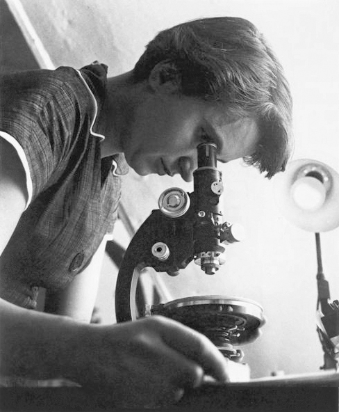

{: width="244" style="float:right;margin:0 0 12px 18px;border-radius:8px;max-width:40%"}

**Rosalind Franklin** (London, 1920 – 1958) was a brilliant chemist and crystallographer. Before working on DNA she had already made important contributions on the structure of coal, and later she would study the structures of tobacco mosaic virus and poliovirus.

## Photo 51

Between 1951 and 1953 she worked at King's College London. There, with PhD student **Raymond Gosling**, she obtained X-ray diffraction images of DNA of unprecedented quality. The most famous, known as **"Photo 51"**, from May 1952, shows a characteristic cross pattern indicating that the molecule is a **helix**.

Franklin also measured the dimensions of the molecule precisely and deduced that the phosphate groups were on the **outside**, something essential for the final model.

## How the data reached Watson and Crick

In January 1953, Maurice Wilkins, Franklin's colleague at King's with whom she had a strained relationship, showed Photo 51 to James Watson **without her knowledge**. Shortly afterwards, Crick had access to an internal report containing Franklin's data. With that information, Watson and Crick built their double-helix model in Cambridge in a few weeks.

In April 1953, *Nature* published three consecutive papers: Watson and Crick's, one by Wilkins and colleagues, and one by Franklin and Gosling providing the experimental data.

## Late recognition

Franklin died of ovarian cancer in **1958**, aged 37. In **1962**, Watson, Crick and Wilkins received the Nobel Prize in Physiology or Medicine. The Nobel is not awarded posthumously, so she could not have been included.

For years she was portrayed as a difficult assistant, above all in Watson's book *The Double Helix* (1968). Later biographies, such as Brenda Maddox's, and a review of the documents have given her work its rightful place. In 2023, two historians who studied her archive argued in *Nature* that Franklin was an **equal contributor** rather than a victim whose data were stolen, even though they were used without her permission.

Today research institutes, prizes and even the European rover that will search for life on Mars bear her name. Read her [profile](../../people/rosalind-franklin/).

## Sources

1. Franklin RE, Gosling RG. Molecular configuration in sodium thymonucleate. *Nature*. 1953;171:740-741.
2. Maddox B. *Rosalind Franklin: The Dark Lady of DNA*. HarperCollins, 2002.
3. Cobb M, Comfort N. What Rosalind Franklin truly contributed to the discovery of DNA's structure. *Nature*. 2023;616:657-660.
4. The Nobel Prize in Physiology or Medicine 1962. nobelprize.org.

*Photo of Rosalind Franklin: MRC Laboratory of Molecular Biology, via Wikimedia Commons, CC BY-SA 4.0 licence.*
