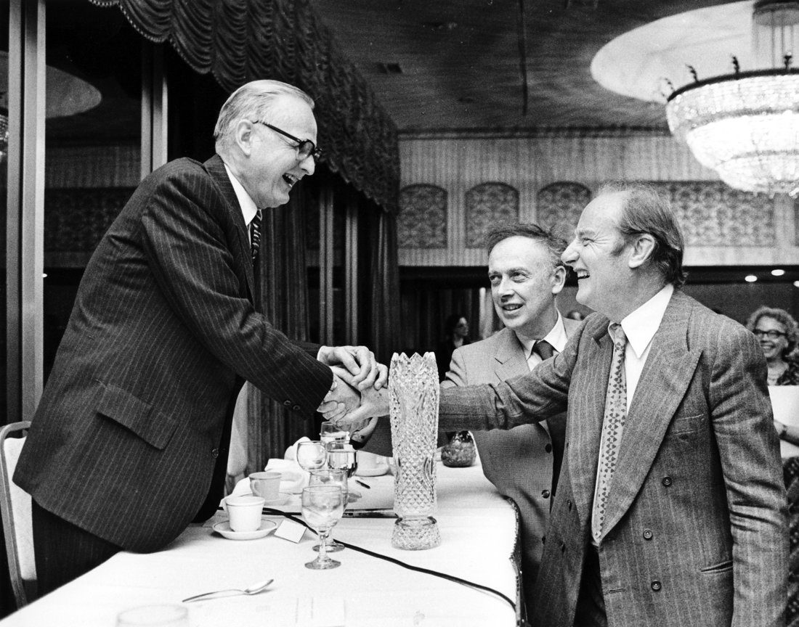

*Maclyn McCarty (left) with Francis Crick (right) and James Watson. Photo: Marjorie McCarty, published in PLOS Biology (2005), CC BY 2.5 licence, via Wikimedia Commons. Date of the photograph not documented.*

## An open question

In the early 1940s, almost all scientists assumed that genes were made of **proteins**. Proteins had 20 different building blocks and seemed complex enough to store information. DNA, with only four "letters", was considered a dull molecule, perhaps just scaffolding.

## Griffith's clue

In 1928, British physician **Frederick Griffith** was working with pneumococci, the bacteria that cause pneumonia. There were two types: one with a capsule, which killed mice, and one without, which was harmless. Griffith noticed something odd: if he injected **heat-killed** dangerous bacteria together with live harmless ones, the mice died, and **live** dangerous bacteria were recovered from their blood. Something had passed from the dead bacteria to the living ones and **transformed** them in a heritable way.

## The 1944 experiment

At the Rockefeller Institute in New York, **Oswald Avery**, **Colin MacLeod** and **Maclyn McCarty** spent more than ten years purifying this "transforming principle". They removed the substances in the extract one by one:

- If they destroyed the **proteins** with enzymes, transformation still happened.
- If they destroyed the **RNA**, it still happened.
- If they destroyed the **DNA**, transformation disappeared.

In **1944** they published the conclusion: the transforming principle is DNA. Read Avery's [profile](../../people/oswald-avery/).

## A cautious reception

Many were not convinced at once. Some thought traces of protein remained in the sample; others that what applied to one bacterium might not apply to other living things. In 1952 the experiment of **Alfred Hershey and Martha Chase** with viruses that infect bacteria provided independent confirmation. And in 1953 the double helix finally explained **how** DNA could store information and copy itself.

Avery died in 1955 without receiving the Nobel Prize, one of the most discussed omissions in the prize's history.

## Why this photo on the cover

The image brings together two moments of the same story: McCarty, who helped show **what** the hereditary material is, and Watson and Crick, who proposed **how** it is built. It is a good reminder that great discoveries are not the work of two names but of many people: Griffith, Avery, MacLeod, McCarty, Chargaff, Franklin, Gosling, Wilkins, Hershey, Chase and many others.

## Sources

1. Avery OT, MacLeod CM, McCarty M. Studies on the chemical nature of the substance inducing transformation of pneumococcal types. *J Exp Med*. 1944;79:137-158.
2. Griffith F. The significance of pneumococcal types. *J Hyg*. 1928;27:113-159.
3. Hershey AD, Chase M. Independent functions of viral protein and nucleic acid in growth of bacteriophage. *J Gen Physiol*. 1952;36:39-56.
4. Lederberg J, Gotschlich EC. A path to discovery: the career of Maclyn McCarty. *PLOS Biology*. 2005;3:e341.
5. McCarty M. *The Transforming Principle: Discovering That Genes Are Made of DNA*. W. W. Norton, 1985.
